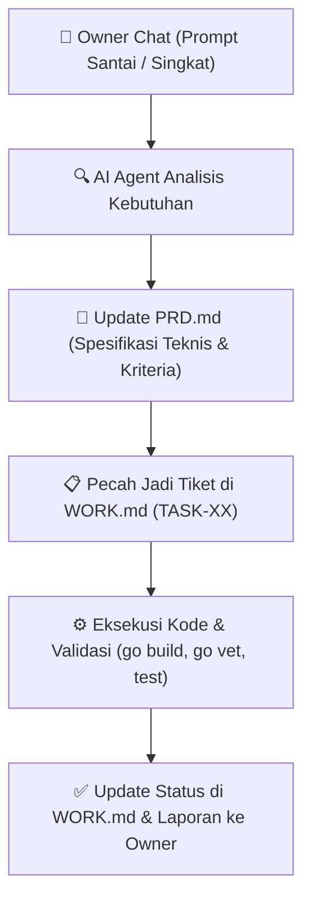

# 📘 Product Requirements Document (PRD) — GotdBot

> **Document Status:** Active (Living Document)  
> **Version:** 2.0.0 (Senior Go Microservice Architecture)  
> **Jargon / Core Philosophy:** *Optimize, Efisien, Easy Using*  
> **Target Scale:** Ribuan sesi Telegram MTProto concurrent, 0 bottleneck microservice, GC & CPU friendly.  
> **Sister Document:** [WORK.md](file:///d:/GotdBot/.agents/WORK.md) (Task Execution Board)  
> **Architecture Blueprint:** [gotdbot-architecture](file:///d:/GotdBot/.agents/skills/gotdbot-architecture/SKILL.md)

---

## 1. 🎯 Executive Summary & Visi Produk

**GotdBot** adalah sistem microservice berbasis Golang untuk manajemen ribuan akun userbot Telegram (MTProto) secara concurrent melalui satu antarmuka kontrol Gateway Bot Telegram yang aman, efisien, dan ramah sumber daya server (VPS).

### 3 Pilar Filosofi (*Optimize, Efisien, Easy Using*):
1. **Optimize (Performa Maksimal):**
   - Zero-bottleneck microservice communication menggunakan Redis Streams Worker Pool.
   - Konkurensi terikat (*bounded goroutines*) untuk menjamin stabilitas VPS 1–2 vCPU.
   - Manajemen alokasi memori ramah Garbage Collector (`GOMEMLIMIT=1100MiB`, `GOGC=50`).
2. **Efisien (Kode Bersih & Hemat Resource):**
   - Single Responsibility Principle: Tidak ada god-file (target < 400-500 LOC per file).
   - State machine terisolasi dengan granular mutex (`panel_state.go`).
   - Anti-thundering-herd menggunakan `crypto/rand` jitter [0, 250ms) saat cooldown `FLOOD_WAIT`.
3. **Easy Using (Pengalaman Pengguna & Developer):**
   - Pengguna: UI Telegram responsif, ReplyKeyboard presisi, wizard input anti-tumpang-tindih.
   - Developer/Owner: Monitoring live di Telegram (`GROUP_DEV` & `MONITOR_TOPIC`), alur kerja prompt-to-PRD otomatis.

---

## 2. 🏛️ Arsitektur Sistem & Invarian (Hukum yang Wajib Dipatuhi)

Setiap fitur baru atau refactoring **WAJIB** tunduk pada invarian berikut:

```
┌────────────────────────────────────────────────────────────────────────┐
│                          INVARIAN SISTEM                               │
├────────────────────────────────────────────────────────────────────────┤
│ 1. UI Safety      : Label & susunan ReplyKeyboard Telegram dilarang    │
│                     diubah sembarangan tanpa persetujuan Owner.        │
│ 2. Callback Data  : Format kontrak string (panel:*, ctrl:*, dll.)      │
│                     wajib dipertahankan 100%.                          │
│ 3. Goroutine Guard: Dilarang membuat unbounded "go func()" di handler. │
│                     Wajib memakai Worker Pool atau Semaphore bounded.  │
│ 4. File Sizing    : Maksimal 400-500 baris per file. Pisahkan domain   │
│                     jika file mulai membengkak.                        │
│ 5. Memory Guard   : Sesi MTProto aktif 24/7 tidak boleh diputus oleh   │
│                     reaper sementara; hanya idle jobs yang dibersihkan.│
└────────────────────────────────────────────────────────────────────────┘
```

```
                          ┌───────────────────────┐
                          │   TELEGRAM BOT API    │
                          └──────────┬────────────┘
                                     │ Webhook / Longpoll
                                     ▼
                     ┌─────────────────────────────────┐
                     │         GATEWAY SERVICE         │
                     │  (Controllers, UI, State, Auth) │
                     └───────┬─────────────────▲───────┘
          XADD "to:ubot"     │                 │  XADD "from:ubot" / "session:events"
                             ▼                 │
                 ┌─────────────────────────────────────────┐
                 │          REDIS STREAMS BROKER           │
                 │   (16 Bounded Workers + PEL Recovery)   │
                 └───────────────────┬─────────────────────┘
                                     │
                                     ▼
                     ┌─────────────────────────────────┐
                     │          UBOT SERVICE           │
                     │  (MTProto Pool, Auth, Updates)  │
                     └───────┬─────────────────▲───────┘
                             │                 │
                Read/Write   ▼                 │ Disaster Recovery Sync
                     ┌───────────────┐  ┌──────┴────────┐
                     │ SQLite (Local)│  │ MongoDB Atlas │
                     └───────────────┘  └───────────────┘
```

---

## 3. 🔄 Alur Standar Kerja: Dari Prompt Santai ke PRD & WORK.md

Dokumen ini memfasilitasi alur kerja di mana **Owner tidak perlu mengetik prompt teknis yang panjang**. Cukup memberikan ide atau keluhan secara santai, dan AI Agent akan memprosesnya melalui siklus berikut:



### Format Formalisasi Kebutuhan di PRD:
Ketika ada ide baru, AI Agent akan mencatatnya ke Section 4 dengan format:
- **Feature ID & Name:** (contoh: `FEAT-05: Auto Schedule Broadcast`)
- **Problem Statement:** Masalah apa yang diselesaikan.
- **Functional Requirements:** Apa yang harus bisa dilakukan bot.
- **Technical Specifications:** Struktur data, Redis message schema, file yang terdampak.
- **Acceptance Criteria:** Syarat pengujian sebelum dinyatakan selesai.

---

## 4. 📦 Katalog Fitur & Spesifikasi Teknis

### [CORE-01] Redis Streams Microservice Broker
- **Status:** ✅ Production (Phase 1)
- **Komponen:** [gateway/applications/broker/redis.go](file:///d:/GotdBot/gateway/applications/broker/redis.go), [ubot/applications/databases/redis.go](file:///d:/GotdBot/ubot/applications/databases/redis.go)
- **Spek:** 16 Bounded Worker Pool per service, Pel recovery (`ID: "0"`), Graceful context drain.

### [CORE-02] Gateway Modular Panel
- **Status:** ✅ Production (Phase 2)
- **Komponen:** `panel_state.go`, `panel_menu.go`, `panel_status.go`, `panel_list.go`, `panel_grup.go`, `panel_remote.go`, `panel_media.go`, `panel_input.go`.
- **Spek:** Isolasi state wizard input, mutex granular, route ReplyKeyboard terpisah.

### [CORE-03] Ubot Modular Engine
- **Status:** ✅ Production (Phase 3)
- **Komponen:** `session_storage.go`, `session_heartbeat.go`, `session_commands.go`, `session_updates.go`, `session_auth.go`, `userbot_service.go`.
- **Spek:** Staggered startup jitter, Crypto jitter FloodWait, session revoked auto-detector.

---

### [ENT-01] Database High-Concurrency & Index Guard (TASK-01)
- **Status:** ✅ Production (TASK-01)
- **Objektif:** Mencegah database lock pada SQLite dan mempercepat query sync MongoDB.
- **Spek Teknis:**
  - SQLite: `PRAGMA journal_mode = WAL; PRAGMA synchronous = NORMAL; PRAGMA cache_size = -64000; PRAGMA busy_timeout = 5000; PRAGMA temp_store = MEMORY; PRAGMA mmap_size = 268435456; PRAGMA wal_autocheckpoint = 1000;`
  - MongoDB Indexes: Compound index `{owner_id: 1, account_id: 1}`, single index `{account_id: 1}`, note index `{owner_id: 1, name: 1}`, sudo index `{owner_id: 1, user_id: 1}`, unique token index `{token: 1}`, dan config index `{owner_id: 1}`.

### [ENT-02] Telegram Live Dashboard & Alert Digest (TASK-02)
- **Status:** ✅ Production (TASK-02)
- **Objektif:** Monitoring status sistem dan log error langsung di grup Telegram tanpa risiko spam/limit.
- **Konfigurasi:**
  - Chat Target: `GROUP_DEV` dari `.env`
  - Topik Target: `MONITOR_TOPIC` dari `.env`
- **Spek Teknis:**
  - **Live Dashboard:** 1 pesan status yang di-update via in-place `editMessageText` setiap 45 detik.
  - **Alert Digest:** Background batching worker (interval 10 detik) untuk event kritis (`SESSION_REVOKED`, `FLOOD_WAIT`, Panic). Maksimum 1 pesan per 10 detik.

### [ENT-03] Structured Logging JSON (`log/slog`) (TASK-03)
- **Status:** ✅ Production (TASK-03)
- **Objektif:** Standardisasi log menjadi format JSON terstruktur bawaan Go 1.21+.
- **Spek Teknis:**
  - Handlers: `slog.NewJSONHandler(os.Stdout)` (default / `LOG_FORMAT=json`) & `slog.NewTextHandler(os.Stdout)` (`LOG_FORMAT=text`).
  - Standard Fields: `timestamp`, `level`, `msg`, `component`, `chat_id`, `owner_id`, `duration`, `error`.

### [ENT-04] Standard Go Project Layout (TASK-04)
- **Status:** ✅ Production (TASK-04)
- **Objektif:** Migrasi ke layout resmi `cmd/` dan `internal/` dengan compiler-enforced encapsulation.
- **Spek Teknis:**
  - Entrypoints: `cmd/gateway/main.go`, `cmd/ubot/main.go`.
  - Private packages: semua di bawah `gateway/internal/` dan `ubot/internal/` — compiler-enforced, tidak bisa diimpor dari luar module.
  - Dockerfile gateway & ubot: diperbarui ke `./cmd/gateway` dan `./cmd/ubot`.
  - `run-dev.ps1`: diperbarui ke `go run ./cmd/gateway` dan `go run ./cmd/ubot`.
  - Legacy `gateway/main/` dan `ubot/main/` dihapus (single entry-point per service).

---

## 5. 🛡️ Matrix Penilaian Mutu (Quality Gates)

Setiap perubahan kode sebelum di-merge atau di-deploy **wajib** memenuhi:
1. `go build ./...` keluar dengan exit code `0` (Zero compile error).
2. `go vet ./...` keluar dengan `0` warning (Zero shadowing / static analysis issue).
3. Unit test lulus 100% (`go test ./...`).
4. Ukuran file tidak melebihi 400–500 LOC.
5. Mutex & State Machine tidak memiliki circular lock (Zero deadlock).
