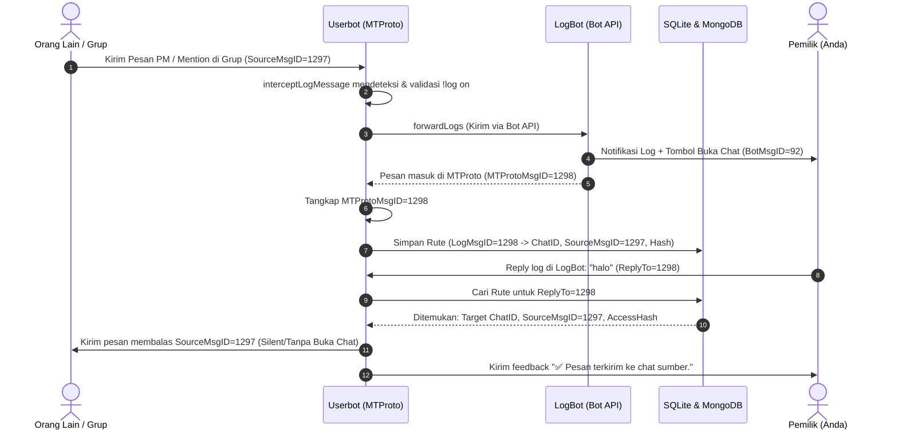
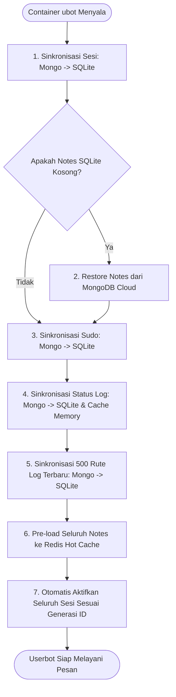

# GotdBot: Panduan Arsitektur Global & Standar Mekanisme

Dokumen ini adalah **referensi tunggal (single source of truth)** untuk arsitektur, siklus data, protokol MTProto, dan aturan modifikasi pada proyek **GotdBot**. Dokumen ini wajib dipatuhi oleh setiap AI Assistant atau pengembang agar tidak terjadi kesalahan pemahaman arsitektur atau regresi fitur.

---

## 1. Arsitektur & Komponen Sistem

GotdBot adalah sistem userbot modular berskala besar berbasis bahasa Go yang memadukan protokol biner **MTProto (Gotd)** dan **Telegram Bot API**.

```mermaid
flowchart TD
    UserClient[Pengguna Telegram / Kontak / Grup] <-->|MTProto Biner| UBot[Service: ubot (Engine Gotd)]
    Owner[Pemilik Akun / Admin] <-->|Telegram Chat / Inline| Gateway[Service: gateway (Bot API)]
    Owner <-->|Reply Log di Chat Bot| LogBot[LogBot (Bot API)]
    
    UBot <-->|Pub/Sub Event & IPC| Redis[(Redis 7)]
    Gateway <-->|Pub/Sub Event & IPC| Redis
    
    UBot <-->|Cache Lokal & Routing Cepat| SQLite[(SQLite /app/data/userbot.db)]
    UBot <-->|Backup Cloud & Disaster Recovery| MongoDB[(MongoDB Cloud Atlas)]
```

### Daftar Service & Tanggung Jawab:

1. **`ubot` (Userbot Engine)**:
   - Berjalan menggunakan library low-level `github.com/gotd/td`.
   - Mengelola pool sesi Telegram MTProto aktif (hingga `MAX_ACTIVE_SESSIONS=550`).
   - Mengeksekusi perintah userbot (`!ping`, `!notes`, `!eval`, `!sh`, `!broadcast`, `!blacklist`, `!log`, `!sudo`).
   - Menangani update stream Telegram (pesan masuk, mention, PM, reply).

2. **`gateway` (Controller / Management Bot)**:
   - Berjalan menggunakan Bot API resmi (`telebot` / HTTP client).
   - Mengatur onboarding user, login via nomor telepon / QR code MTProto, dan callback manajemen akun.
   - Berkomunikasi dengan `ubot` melalui broker Redis.

3. **`redis` (Broker & Hot Cache)**:
   - Komunikasi antar-proses (IPC) melalui Redis Pub/Sub (`ubot` ↔ `gateway`).
   - Hot-cache untuk catatan aktif (`notes`) agar query inline keyboard instan tanpa menyentuh disk.

4. **`sqlite` (Local High-Performance Database)**:
   - File: `/app/data/userbot.db`.
   - Menyimpan sesi terenkripsi aktif (`sessions`), status prefix, daftar sudo lokal, catatan lokal, dan tabel perutean balasan log (`log_routes`).
   - Kecepatan baca/tulis < 1 milidetik, menjadi garda depan saat user membalas log.

5. **`mongodb` (Cloud Persistent & Disaster Recovery)**:
   - Backup permanen saat SQLite lokal hilang (misal container recreate / redeploy VPS).
   - Menyimpan collection:
     - `userbot_sessions`: Sesi terenkripsi dan metadata owner.
     - `userbot_notes`: Seluruh catatan dan cache media inline.
     - `userbot_sudo`: Akses pengguna istimewa.
     - `userbot_log_status`: Status saklar fitur log (`!log on` / `!log off`).
     - `userbot_log_routes`: Riwayat perutean pesan log ke pesan sumber.
     - `userbot_log_media`: Metadata media MTProto & Telegram Bot `file_id`.

---

## 2. Dual-Layer Telegram: MTProto vs Bot API

Pemahaman mendasar yang **TIDAK BOLEH** tertukar:

| Aspek | Sisi Userbot (MTProto) | Sisi LogBot / Gateway (Bot API) |
| :--- | :--- | :--- |
| **Identitas Akun** | Akun pengguna Telegram (User Client) | Akun Bot Telegram (`@LogBot`) |
| **Protokol** | MTProto biner langsung ke Data Center Telegram | HTTPS REST JSON ke `api.telegram.org` |
| **Library** | `github.com/gotd/td` | HTTP Client / Telebot |
| **Token / Sesi** | Session string terenkripsi (`API_ID`, `API_HASH`) | `BOT_TOKEN` / `LOGBOT_TOKEN` |
| **Kirim Pesan** | Memerlukan `InputPeer` (`UserID` + `AccessHash`) | Cukup `chat_id` numerik |
| **Message ID Scope**| **Message ID independen per obrolan/user** | **Message ID independen di mailbox bot** |

---

## 3. Masalah Krusial: MTProto Message ID ≠ Bot API Message ID

> [!CAUTION]
> **JANGAN PERNAH** menganggap `MessageID` yang dikembalikan Bot API sama dengan `MessageID` yang dilihat oleh userbot MTProto pada obrolan pribadi (Private Chat)!

### Mengapa ID-nya Berbeda?
Di Telegram, ruang ID pesan untuk **Private Chat (1-on-1 dialog)** bersifat independen untuk tiap partisipan:
1. Saat LogBot mengirim pesan teks via Bot API (`/sendMessage`), Telegram Bot API mengembalikan ID pesan dari sudut pandang bot (misal: `ID = 92`).
2. Namun, saat pesan itu masuk ke aplikasi Telegram user (dan diterima userbot melalui MTProto), pesan tersebut mendapat nomor ID lokal di obrolan user (misal: `ID = 1298`).
3. Saat user menekan **Swipe-Reply** di chat bot pada pesan tersebut, client Telegram user mengirimkan:
   $$\text{ReplyToMsgID} = 1298$$
4. Jika database menyimpan `92`, maka pencarian rute untuk `1298` **PASTI GAGAL** (`Route tidak ditemukan`).

### Solusi Wajib yang Diimplementasikan:
1. **Penangkapan Langsung di Update Handler**:
   - Di `command_log.go` (`interceptLogMessage`), saat userbot menerima pesan masuk dari `logBotID` (`!msg.Out && p.UserID == logBotID`), userbot mencatat MTProto ID tersebut ke `s.lastLogBotMsgID.Store(ownerID, msg.ID)`.
2. **Penyimpanan Berbasis MTProto ID**:
   - Fungsi `forwardLogs` menunggu update handler dan memprioritaskan MTProto ID:
     1. Ambil dari `lastLogBotMsgID` (MTProto ID saat pesan tiba).
     2. Fallback via `resolveLogMTProtoMsgID` (`MessagesGetHistory` 5 pesan terakhir dari LogBot).
     3. Fallback terakhir ke Bot API ID (jika MTProto belum terbaca).
3. **Simpan ke Database**:
   - `SaveLogRoute` di SQLite dan MongoDB **HARUS** menggunakan MTProto message ID agar cocok saat di-reply.

---

## 4. Mekanisme Fitur Log & Auto-Reply Sumber



### Rincian Mekanisme Penting:

1. **Format Teks Log**:
   - Menampilkan konten dalam `<blockquote expandable>`.
   - Menampilkan tautan profil pengirim `<a href="tg://user?id=%d">Nama</a>`.
   - Menampilkan nomor **ID Pengguna** dan **ID Pesan Sumber** secara eksplisit.

2. **Tombol "Buka Chat"**:
   - Untuk Pesan Pribadi (PM): Menggunakan deep link `tg://openmessage?user_id=%d&message_id=%d` (langsung membuka chat dan scroll ke pesan terkait).
   - Untuk Grup/Supergroup: Menggunakan `https://t.me/c/%d/%d`.
   - Catatan: Telegram Bot API menolak `tg://user?id=` di inline keyboard (`BUTTON_URL_INVALID`), namun menerima format `tg://openmessage`.

3. **Forward Media (Zero Download & Zero Upload)**:
   - Jika pesan sumber berisi media yang downloadable:
     1. Userbot mem-forward pesan media ke LogBot via MTProto (`MessagesForwardMessages`).
     2. LogBot menangkap `file_id` dari media tersebut via Bot API `getUpdates`.
     3. LogBot mengirimkan media ke Owner menggunakan `file_id` (tanpa menyedot bandwidth download/upload VPS).
     4. Pesan forward sementara di LogBot langsung dihapus otomatis (`logDeleteMessageViaBot`).
     5. Jika forward gagal, ada fallback download streaming terbatas ke memory (`logDownloadMediaFile`).

4. **Penanganan Pesan Terhapus (`REPLY_MESSAGE_ID_INVALID`)**:
   - Jika saat user membalas, ternyata pengirim di grup/PM sudah menghapus pesan aslinya, Telegram MTProto akan mengembalikan error `REPLY_MESSAGE_ID_INVALID`.
   - Kode di `replyToLoggedMessage` otomatis menangkap error ini, menghapus parameter `ReplyTo`, dan mengirimkan pesan sebagai pesan baru ke chat tersebut agar balasan tidak hilang.

5. **Feedback Interaktif di Chat Bot**:
   - Balasan sukses: Mengirim konfirmasi `✅ Pesan terkirim ke chat sumber.`
   - Balasan gagal: Mengirim `❌ Gagal mengirim balasan ke chat sumber: [error]`.
   - Rute tidak ditemukan: Mengirim `⚠️ Gagal membalas: Rute pesan sumber tidak ditemukan...`.

---

## 5. Protokol MTProto & Keamanan Akses (`AccessHash`)

> [!IMPORTANT]
> Di MTProto Telegram, **TIDAK BISA** mengirim pesan ke pengguna lain hanya dengan `UserID` saja.

### Struktur Peer MTProto:
- `tg.InputPeerUser{ UserID: ..., AccessHash: ... }`
- `tg.InputPeerChannel{ ChannelID: ..., AccessHash: ... }`
- `tg.InputPeerChat{ ChatID: ... }` (Hanya untuk grup kecil/legacy)

### Mengapa `AccessHash` Wajib?
1. Telegram menggunakan `AccessHash` sebagai bukti izin kriptografis bahwa akun Anda pernah berinteraksi atau melihat entitas tersebut.
2. Jika `AccessHash` bernilai `0` atau salah, Telegram mengembalikan `PEER_ID_INVALID` atau `ACCESS_HASH_INVALID`.
3. **Penyimpanan**:
   - Saat update masuk, entitas disimpan di `s.userAccessHashes` dan `s.channelAccessHashes`.
   - Pada `SaveLogRoute`, nilai `AccessHash` ikut disimpan ke SQLite dan MongoDB.
   - Saat membalas, jika hash kosong di rute, ada mekanisme fallback resolving menggunakan cache internal dan `UsersGetUsers`.

---

## 6. Update Dispatcher & `userbotUpdateHandler`

Telegram mengirimkan banyak varian constructor update untuk pesan baru:
- `*tg.UpdateNewMessage` (Pesan user/grup biasa)
- `*tg.UpdateNewChannelMessage` (Pesan supergroup/channel)
- `*tg.UpdateShortMessage` (Format pendek untuk PM)
- `*tg.UpdateShortChatMessage` (Format pendek untuk Basic Group)
- `*tg.Updates` / `*tg.UpdatesCombined` (Bundle update beserta entitas `Users` dan `Chats`)

### Fungsi `userbotUpdateHandler`:
Mengonversi format ringkas (`UpdateShortMessage` & `UpdateShortChatMessage`) menjadi `*tg.Message` standar lengkap dengan atribut `Flags`, `Out`, `Mentioned`, `ID`, `PeerID`, dan `ReplyTo`, lalu menyalurkannya ke `dispatcher.Handle`.

---

## 7. Startup Sync & Disaster Recovery Flow

Ketika container `ubot` pertama kali menyala, fungsi `service.Restore(ctx)` dieksekusi secara otomatis:



---

## 8. Standar Deployment & Docker di VPS

File `docker-compose.yaml` menggunakan konfigurasi build lokal untuk service Go:

```yaml
  ubot:
    build:
      context: ./ubot
      dockerfile: Dockerfile
    image: ghcr.io/kenboo14/gotdbot-ubot:latest
    ...
```

### Prosedur Wajib Rebuild di VPS:
Jangan hanya menjalankan `docker compose restart`. Jika ada perubahan kode Go di Git, wajib jalankan:

```bash
cd ~/GotdBot
git pull origin master
docker compose build --no-cache ubot
docker compose up -d ubot
docker compose logs -f ubot
```

---

## 9. Pantangan & Aturan Mutlak bagi AI Assistant

Bagi AI Assistant mana pun yang melanjutkan tugas di repositori ini, patuhi aturan berikut:

1. **JANGAN Menghapus Penyimpanan SQLite/MongoDB untuk Rute Log**:
   - Ide "cukup ambil dari tombol Buka Chat tanpa database" adalah **salah secara teknis** di arsitektur MTProto karena Telegram tidak mengirimkan tombol saat user melakukan reply dan tidak menyertakan `AccessHash`.
2. **JANGAN Mengabaikan Perbedaan ID Bot API vs MTProto**:
   - Selalu simpan rute log menggunakan MTProto message ID yang dilihat oleh userbot.
3. **JANGAN Menghapus Blok `build:` di `docker-compose.yaml`**:
   - Blok `build:` wajib ada agar `docker compose build ubot` mengompilasi file Go lokal dan tidak mengambil image lama dari cache registry.
4. **JANGAN Mengubah Format Link Inline Button Sembarangan**:
   - Hindari `tg://user?id=` pada tombol inline keyboard URL (akan error `BUTTON_URL_INVALID`). Gunakan `tg://openmessage?user_id=...&message_id=...` untuk PM atau tautan `https://t.me/...`.
5. **Selalu Uji Kompilasi Lokal Sebelum Memberi Perintah ke User**:
   - Jalankan `cd ubot; go build -v ./...` dan unit test database `cd ubot; go test -v ./applications/databases/...` untuk memastikan nol sintaks error.

