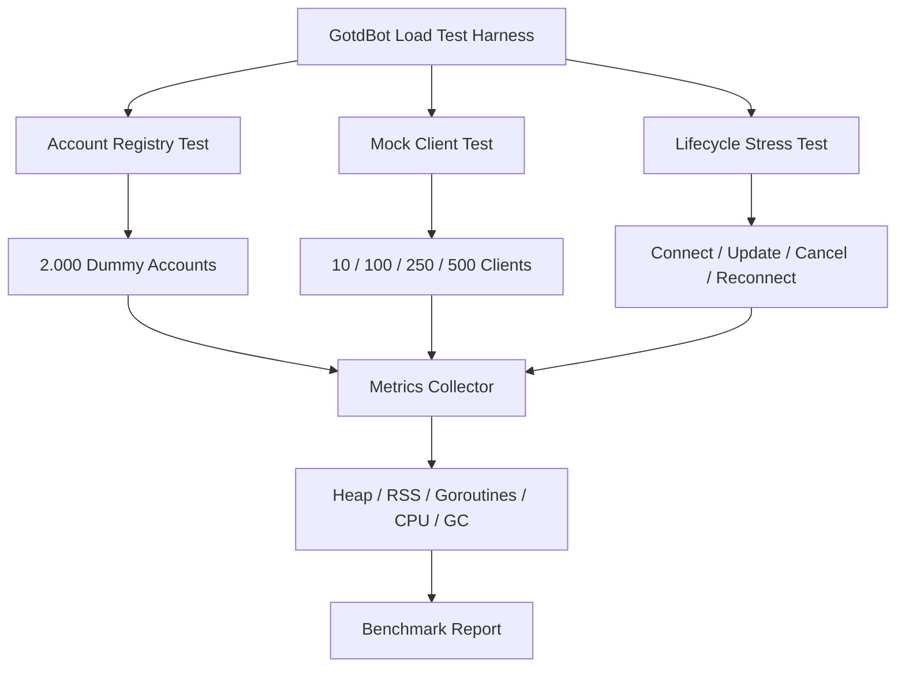

# GotdBot Load Test Simulator

Saya setuju untuk membuat **Load Test Simulator**, dan menurut saya ini langkah yang tepat untuk GotdBot sebelum melakukan pengujian skala besar.

Namun, ada beberapa klaim dalam dokumen tersebut yang perlu dikoreksi agar hasil pengujiannya tidak menyesatkan.

## 1. Tiga Hal yang Perlu Diluruskan

### A. 2.000 akun terdaftar belum terbukti hanya membutuhkan 5–10 MB

Angka tersebut masih estimasi. Kita perlu mengukur seluruh struktur data yang benar-benar digunakan GotdBot, termasuk map, cache, string, slice, dan overhead objek Go.

### B. 300–500 koneksi per VPS belum merupakan kapasitas terverifikasi

Angka 1,5–2,5 MiB per client masih hipotesis. Belum cukup untuk menyatakan 500 koneksi aman pada VPS RAM 2 GB.

### C. Mock client bukan pengganti MTProto asli

Mock bisa mengukur:

- Overhead goroutine.
- Penggunaan struktur data.
- Concurrency.
- Context cancellation.
- Simulasi update.
- Lifecycle dan cleanup.

Tetapi mock tidak mengukur biaya enkripsi, buffer, RPC, ping, dan koneksi jaringan MTProto sebenarnya.

Jadi, hasil simulator harus diberi label **simulasi aplikasi**, bukan kapasitas koneksi Telegram.

## 2. Desain Simulator yang Direkomendasikan



### Mode pengujian

| Mode | Jumlah | Fokus |
|---|---:|---|
| Registry | 2.000 akun | Memori metadata |
| Mock concurrency | 10–500 client | Goroutine dan lifecycle |
| Stress test | 500–2.000 client tiruan | Stabilitas dan cleanup |

Setiap pengujian harus bisa dijalankan berulang kali dengan hasil yang dapat dibandingkan.

## 3. Prompt untuk Codex

Berikut prompt yang bisa langsung diberikan kepada Codex.

---

# TASK: Implement Isolated GotdBot Load Test Simulator

## Objective

Buat Load Test Harness untuk mengukur kemampuan GotdBot mengelola hingga 2.000 akun terdaftar dan ratusan mock client aktif secara bersamaan.

Simulator wajib terisolasi dari production runtime dan tidak boleh memengaruhi akun Telegram sungguhan.

## PHASE 1 — READ-ONLY AUDIT

Sebelum membuat kode:

1. Baca seluruh `AI_GUIDE.md`.
2. Audit struktur project dan arsitektur `userbot_service.go`.
3. Identifikasi:
   - Struktur data akun.
   - Map dan cache per akun.
   - Lifecycle `activate()`.
   - Context cancellation.
   - Reaper.
   - Dispatcher dan jalur update.
4. Identifikasi bagian yang aman untuk digunakan kembali dalam simulator.
5. Jangan mengasumsikan mock client setara dengan client MTProto asli.

Laporkan hasil audit dan rencana implementasi sebelum mengubah file.

## PHASE 2 — BUILD ISOLATED SIMULATOR

Buat simulator terpisah, misalnya:

`ubot/simulator/`

Simulator tidak boleh:

- Menjalankan production entrypoint.
- Memanggil `Restore()` production.
- Menghubungkan MongoDB production.
- Menggunakan session Telegram sungguhan.
- Membuat koneksi MTProto sungguhan.
- Mengubah data akun production.

Gunakan in-memory mock storage.

### Test A: Account Registry

Simulasikan:

- 100 akun.
- 500 akun.
- 1.000 akun.
- 2.000 akun.

Ukur:

- Heap Alloc.
- Heap Inuse.
- TotalAlloc.
- Number of accounts.
- Goroutines.

Pastikan pengukuran membandingkan baseline sebelum dan sesudah pembuatan akun.

### Test B: Mock Client Concurrency

Simulasikan:

- 10 client.
- 100 client.
- 250 client.
- 500 client.

Setiap mock client harus mendukung:

- Start.
- Idle.
- Simulated incoming update.
- Context cancellation.
- Stop.
- Cleanup.

Gunakan goroutine dan context secara benar.

Pastikan tidak ada goroutine yang tertinggal setelah seluruh client dihentikan.

### Test C: Lifecycle Stress

Uji:

- Start banyak client bersamaan.
- Start client yang sama secara bersamaan.
- Cancel bersamaan.
- Reconnect setelah cancellation.
- Update ketika client aktif.
- Cleanup berulang kali.
- Deteksi race condition.

Pastikan satu account tidak dapat memiliki dua mock client aktif secara tidak sengaja.

## PHASE 3 — METRICS

Gunakan:

- `runtime.ReadMemStats`
- `runtime.NumGoroutine`
- `runtime.GC`
- `runtime/metrics` bila relevan.

Catat:

- HeapAlloc.
- HeapInuse.
- HeapSys.
- TotalAlloc.
- Sys.
- NumGC.
- Goroutines.
- Jumlah akun.
- Jumlah client aktif.
- Durasi pengujian.

Jika memungkinkan, ukur RSS proses secara terpisah. Jangan menyamakan HeapAlloc dengan RSS.

Lakukan pengukuran:

1. Sebelum simulasi.
2. Setelah akun dibuat.
3. Setelah mock client aktif.
4. Setelah seluruh client dihentikan.
5. Setelah GC.

## PHASE 4 — REPORT

Hasil harus ditampilkan di terminal dalam tabel yang mudah dibaca.

Contoh:

| Scenario | Accounts | Active Clients | Heap Inuse | RSS | Goroutines |
|---|---:|---:|---:|---:|---:|
| Registry | 2.000 | 0 | ... | ... | ... |
| Mock | 2.000 | 100 | ... | ... | ... |
| Mock | 2.000 | 250 | ... | ... | ... |
| Mock | 2.000 | 500 | ... | ... | ... |

Nilai harus berasal dari pengukuran aktual, bukan angka perkiraan.

Jelaskan bahwa hasil mock tidak mewakili penggunaan resource MTProto asli.

## PHASE 5 — VALIDATION

Jalankan:

```bash
go test ./...
go test -race ./...
go vet ./...
go build ./...
```

Tambahkan test khusus simulator.

Pastikan:

- Tidak ada goroutine leak.
- Tidak ada race.
- Tidak ada data production yang tersentuh.
- Pengujian dapat dijalankan berulang kali.
- Semua client berhenti dengan benar.

## STRICT SCOPE

Jangan mengubah:

- `userbot_service.go`
- Production activation lifecycle.
- Production Reaper.
- Dispatcher.
- Session MongoDB.
- Pprof implementation.

Jangan melakukan:

- Commit.
- Push.
- Deployment.
- Restart VPS.

Jika perlu menyentuh production code agar simulator dapat berjalan, hentikan dan laporkan alasannya terlebih dahulu.

## FINAL REPORT

Laporkan:

1. File yang dibuat.
2. File yang diubah.
3. Desain simulator.
4. Hasil setiap skenario.
5. Heap dan RSS aktual.
6. Jumlah goroutine sebelum dan sesudah cleanup.
7. Hasil race test.
8. Keterbatasan simulasi.
9. Rekomendasi tahap berikutnya untuk validasi MTProto nyata.

Jangan menyatakan kapasitas 2.000 koneksi Telegram terbukti hanya berdasarkan mock client.

---

## 4. Urutan Pelaksanaan

1. Selesaikan simulator dan pastikan tidak ada kebocoran goroutine.
2. Jalankan simulator di komputer lokal.
3. Jalankan simulator di VPS RAM 2 GB untuk membandingkan resource.
4. Bandingkan hasilnya dengan pengukuran pprof GotdBot yang sudah dilakukan.
5. Baru lakukan validasi bertahap menggunakan akun MTProto sungguhan.

## Kesimpulan

Rekomendasi saya adalah menyetujui implementasi ini dengan scope di atas.

Tujuan pertamanya bukan membuktikan 2.000 koneksi Telegram, melainkan mendapatkan angka dasar yang terukur tentang seberapa efisien GotdBot mengelola 2.000 akun dan ratusan lifecycle client tiruan.